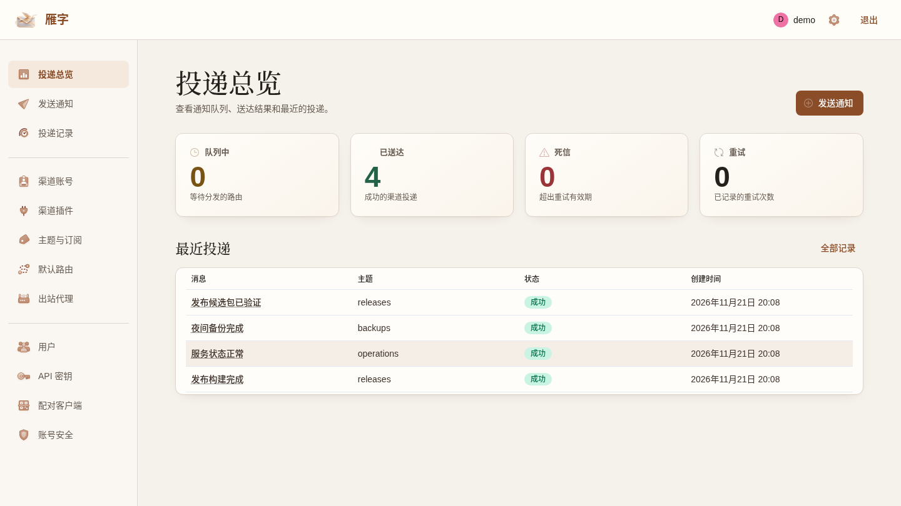
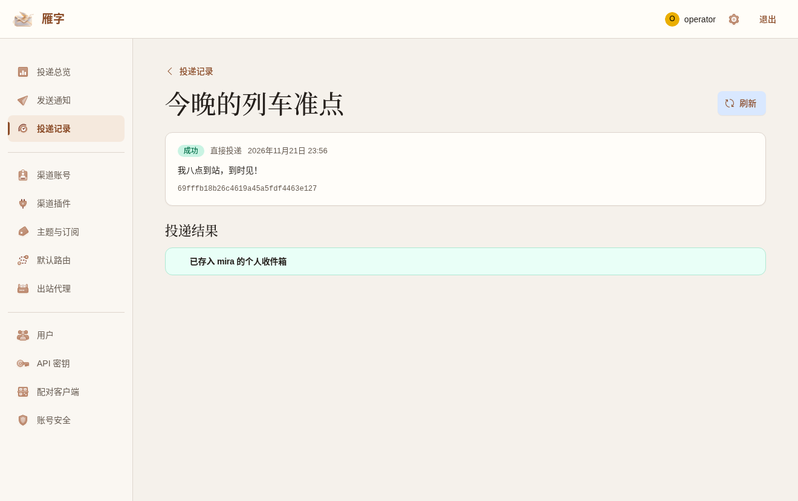
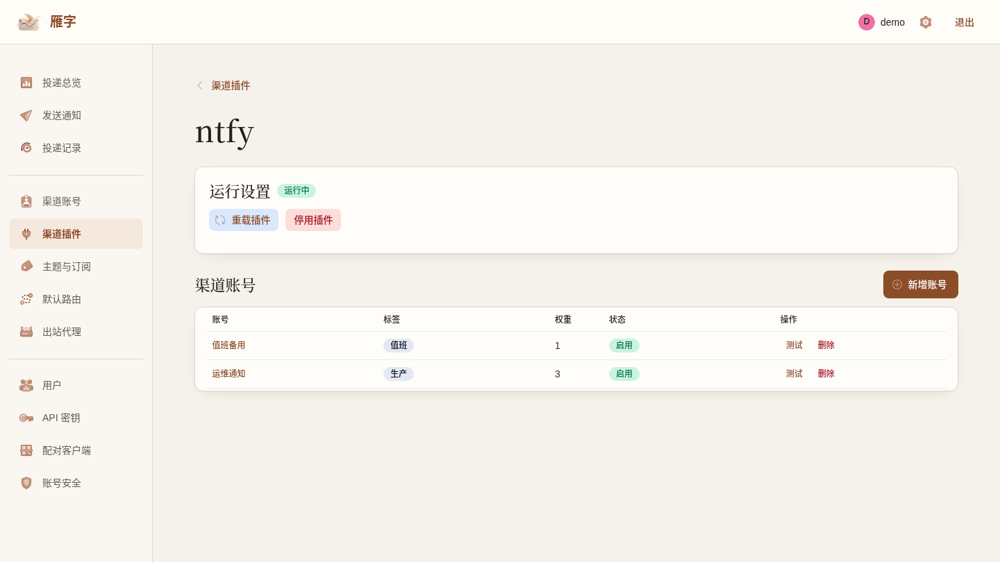
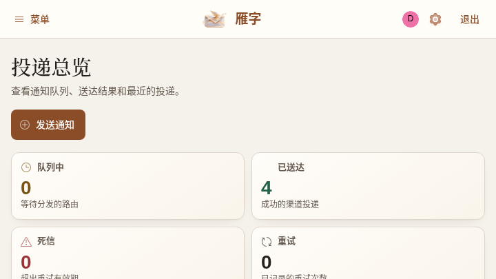
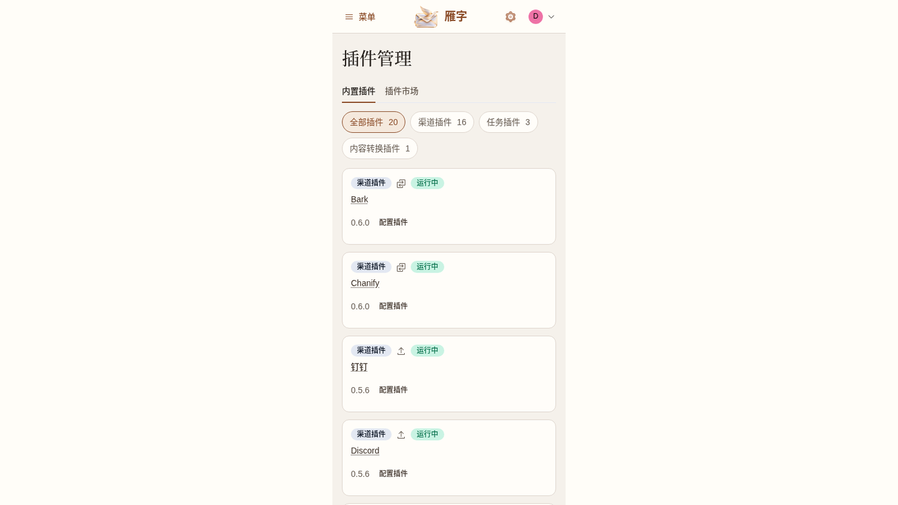
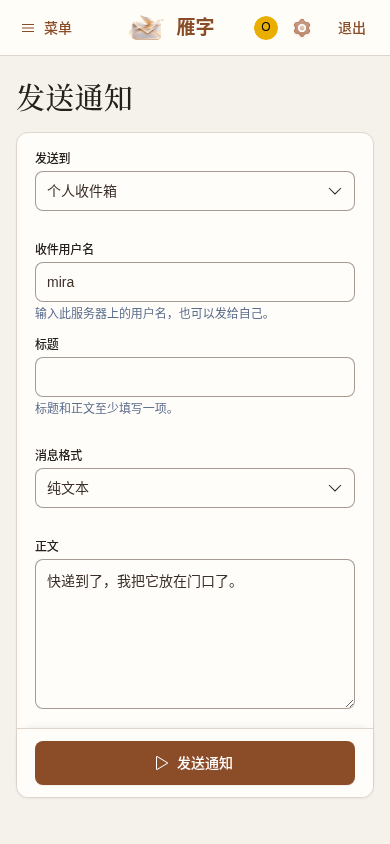

# 雁字

雁字的懒猫微服安装包。服务端提供通知渠道、主题、路由策略、重试和投递记录管理。懒猫安装包使用已发布的服务端镜像。 [上游项目](https://github.com/ca-x/anser) · [安装包](https://github.com/lazycat-contrib/anser-lzcapp/releases)

## 安装与登录

- 需要懒猫微服 1.6.0 或更高版本。应用入口仅向微服管理员开放。
- 在安装向导中填写管理员用户名和密码。向导默认提供随机密码。雁字只在空数据库中创建首个管理员，重新部署会保留现有账号。
- 从微服打开应用后，登录页会自动填充并提交向导中的凭据。若在雁字中启用了双重验证，继续输入验证码或恢复码。修改雁字密码后，可更新安装向导中的登录凭据。
- SQLite 数据库和主密钥保存在应用持久目录。迁移时请一并保留。
- 渠道使用出站代理时，在向导的出站主机允许列表中填写代理和目标主机。使用懒猫通知渠道时，请授权发送通知权限。

## 界面截图

截图采集自运行中的雁字，使用演示数据。移动端展示横屏管理和竖屏发送。

桌面端投递详情和渠道设置

移动端

## 发布自动化

GitHub Actions 跟踪 `ghcr.io/ca-x/anser` 的稳定版本，将服务镜像复制到懒猫镜像仓库，再构建带版本号的 Linux amd64 LPK。喵喵商店使用经过校验的 GitHub Release 文件。官方商店提交同一份 LPK 及截图，提交后由商店审核。

发布工作流读取 `LZC_API_TOKEN`、`APPSTORE_URL` 和 `APPSTORE_TOKEN`。可使用已授权本仓库的组织 Secrets，或由仓库管理员配置同名 Secrets。 [发布流水线](https://github.com/lazycat-contrib/anser-lzcapp/actions/workflows/lazycat.yml)
